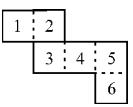

# Mathematics (Grade 5)

**ID**: f7d99005
**难度**: medium
**题型**: multiple_choice

## 题目
右图是正方体纸盒展开的平面图，在正方体纸盒上2号面相对的面是（）号面。

## 解答

**答案**: 6

1. Step1:明确问题是找出正方体纸盒展开平面图中2号面相对的面
2. Step2:回忆正方体表面展开图的特征，即相对面上的两个正方形中间一定只隔一个正方形
3. Step3:观察展开图，找到与2号面中间只隔一个正方形的面为6号面

## 知识点

**知识点**:
  - 长方体的展开与折叠

---
