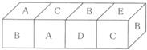

# Mathematics (Grade 5)

**ID**: f8938829
**难度**: medium
**题型**: multiple_choice

## 题目
如图，四个完全相同的正方体木块并排在一起，木块的六个面上写有A、B、C、D、E、F六个不同的字母．那么，与D面相对的是(    )面．

## 解答

**答案**: C

1. Step1:观察第一个和第二个正方体，发现A与B和C相邻
2. Step2:观察第四个正方体，由于A与B、C相邻，所以推出E的对面是A，即第四块正方体的正下方是A
3. Step3:观察第三块正方体，看到D与B相邻
4. Step4:因为A与B、C相邻，D与B相邻，所以推断D只可能在C的对面，也就是第四块正方体面向里面的那一面
5. Step5:得出D的对面是C

## 知识点

**知识点**:
  - 正方体的展开图．

---
