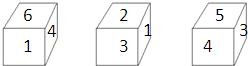

# Mathematics (Grade 5)

**ID**: fc062320
**难度**: medium
**题型**: multiple_choice

## 题目
如图一个正方体的六面都标上数字，请问5对面是（  ）
A．6
B．1
C．2

## 解答

**答案**: B

1. Step1:观察图形可知，4与1、6、3、5相邻，由此可推出4与2是相对面
2. Step2:又观察到3与1、2、4、5相邻，所以可推出3与6是相对面
3. Step3:正方体共有六面，已经确定4与2相对，3与6相对，那么剩下的1与5就是相对面
4. Step4:题目问5对面是多少，因为1与5相对，所以答案是1，即选B

## 知识点

**知识点**:
  - 正方体的特征．

---
