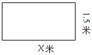

# Mathematics (Grade 5)

**ID**: 0d278ec7
**难度**: medium
**题型**: short_answer

## 题目
列方程求x的值：长方形周长9米．

## 解答

**答案**: 3

1. Step1:根据长方形周长公式（长+宽）×2=长方形的周长，已知宽为1.5米，长为x米，周长为9米，列出方程(x + 1.5)×2 = 9
2. Step2:对方程(x + 1.5)×2 = 9两边同时除以2，得到x + 1.5 = 4.5
3. Step3:对x + 1.5 = 4.5两边同时减去1.5，得到x = 3

## 知识点

**知识点**:
  - 长方形的周长

---
