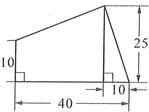

# Mathematics (Grade 5)

**ID**: 101b5492
**难度**: medium
**题型**: short_answer

## 题目
求组合图形的面积：(单位：厘米)

## 解答

1. Step1:将组合图形分割成一个梯形和一个三角形
2. Step2:计算梯形的上底为10厘米，下底为25厘米，高为40厘米，根据梯形面积公式S=(a + b)×h÷2，可得梯形面积为(10 + 25)×40÷2 = 700平方厘米
3. Step3:计算三角形的底为10厘米，高为25厘米，根据三角形面积公式S = a×h÷2，可得三角形面积为10×25÷2 = 125平方厘米
4. Step4:将梯形面积和三角形面积相加，得到组合图形面积为700 + 125 = 825平方厘米

## 知识点

**知识点**:
  - 组合图形的面积．

---
