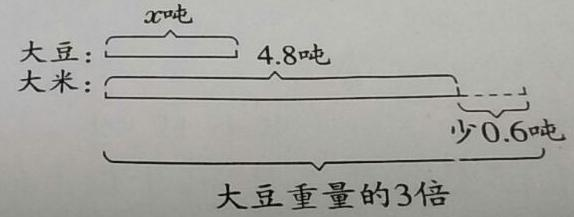

# Mathematics (Grade 5)

**ID**: 120b2d77
**难度**: medium
**题型**: short_answer

## 题目
看图列方程并求解.

 4.8吨，0.6吨，3

## 解答

**答案**: 1.8

1. Step1:设大豆的重量为x吨
2. Step2:根据图中信息可知，大米的重量是4.8吨，且大米的重量加上0.6吨等于大豆重量的3倍，由此列出方程3x = 4.8 + 0.6
3. Step3:求解方程3x = 4.8 + 0.6，先计算等式右边4.8 + 0.6 = 5.4，得到3x = 5.4
4. Step4:方程两边同时除以3，即x = 5.4÷3，解得x = 1.8

## 知识点

**知识点**:
  - --

---
