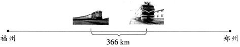

# Mathematics (Grade 5)

**ID**: 1762f7ed
**难度**: medium
**题型**: short_answer

## 题目
一列客车和一列货车同时从福州出发开往郑州。12小时后，货车落后客车366km，客车每小时行116km，货车每小时行多少千米？

## 解答

**答案**: 85.5

1. Step1:设货车每小时行x千米
2. Step2:根据12小时后货车落后客车366km，可列出方程116×12－12x＝366
3. Step3:求解上述方程，先计算116×12 = 1392，得到1392 - 12x = 366
4. Step4:移项可得12x = 1392 - 366
5. Step5:计算1392 - 366 = 1026，即12x = 1026
6. Step6:两边同时除以12，解得x = 1026÷12 = 85.5

## 知识点

**知识点**:
  - 小学数学;数与代数;应用题;常见的数学问题;行程问题;列方程解应用题;列方程解应用题（两步需要逆思考）

---
