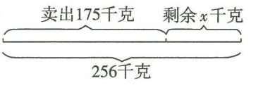

# Mathematics (Grade 5)

**ID**: 1df8bc16
**难度**: medium
**题型**: short_answer

## 题目
看图列方程并解答。

 卖出175千克    剩余x千克   256千克

## 解答

**答案**: 81

1. Step1:根据图中信息可知，卖出的重量加上剩余的重量等于总重量，所以列出方程175 + x = 256
2. Step2:为求解x，方程两边同时减去175，即x = 256 - 175
3. Step3:计算256 - 175的结果为81，所以x = 81，即剩余81千克

## 知识点

**知识点**:
  - 简易方程;练习一

---
