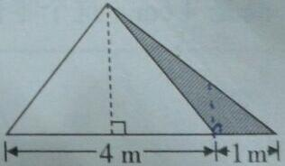

# Mathematics (Grade 5)

**ID**: 1e24b3d0
**难度**: medium
**题型**: short_answer

## 题目
如下图，阴影部分的面积是1.6m²，求空白部分三角形的面积。

 4m，1m

## 解答

**答案**: 6.4

1. Step1:根据三角形面积公式，由阴影部分面积1.6m²和底1m，可得阴影部分三角形的高为1.6×2÷1 = 3.2m
2. Step2:因为阴影部分和空白部分三角形高相同，空白部分三角形底为4m，所以空白部分三角形面积为4×3.2÷2 = 6.4m²

## 知识点

**知识点**:
  - --

---
