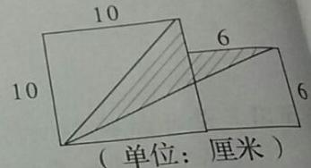

# Mathematics (Grade 5)

**ID**: 280cccc4
**难度**: medium
**题型**: short_answer

## 题目
如图所示，求阴影部分面积．

 10  10  6   6
 （单位：厘米）

## 解答

**答案**: 38

1. Step1:计算大正方形的面积，根据正方形面积公式S=a²（a为边长），可得大正方形面积为10×10 = 100平方厘米
2. Step2:计算小正方形的面积，同理可得小正方形面积为6×6 = 36平方厘米
3. Step3:计算大正方形中空白三角形的面积，根据三角形面积公式S=ah÷2（a为底，h为高），此三角形底和高均为10厘米，面积为10×10÷2 = 50平方厘米
4. Step4:计算小正方形与大正方形组合图形中另一个空白三角形的面积，其底为10 + 6 = 16厘米，高为6厘米，面积为16×6÷2 = 48平方厘米
5. Step5:根据阴影部分面积等于大小两个正方形的面积和减去空白的两个三角形的面积，即100 + 36 - 50 - 48 = 38平方厘米

## 知识点

**知识点**:
  - --

---
