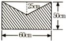

# Mathematics (Grade 5)

**ID**: 2f5713bf
**难度**: medium
**题型**: short_answer

## 题目
求图中阴影部分的面积．（单位：厘米）

## 解答

**答案**: 2250

1. Step1:根据题意可知，阴影部分的面积 = 长方形面积 - 空白部分三角形的面积
2. Step2:长方形的长为60厘米，宽为50厘米，根据长方形面积公式S = a×b（a为长，b为宽），可得长方形面积为60×50 = 3000平方厘米
3. Step3:空白部分三角形的底为60厘米，高为25厘米，根据三角形面积公式S = a×h÷2（a为底，h为高），可得三角形面积为60×25÷2 = 750平方厘米
4. Step4:用长方形面积减去三角形面积，即3000 - 750 = 2250平方厘米，得到阴影部分面积

## 知识点

**知识点**:
  - 组合图形的面积．

---
