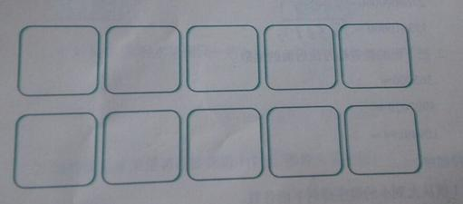

# Mathematics (Grade 5)

**ID**: 30530e7f
**难度**: medium
**题型**: short_answer

## 题目
请你在下面的10张卡片背面分别写上“1”或“10”，使摸到“1”的可能性最大，摸到“10”的可能性最小

## 解答

**答案**: 6, 4

1. Step1:明确题目要求是在10张卡片背面写'1'或'10'，使摸到'1'可能性最大，摸到'10'可能性最小
2. Step2:根据可能性大小与数量多少相关，要满足条件则写'1'的卡片数量要多于写'10'的卡片数量
3. Step3:因为卡片总数是10张，所以可以尝试不同数量组合，当写'1'的卡片为6张，写'10'的卡片为4张时，满足写'1'的卡片数多于写'10'的卡片数，也满足卡片总数为10张的条件
4. Step4:得出写'1'的卡片数量为6，写'10'的卡片数量为4

## 知识点

**知识点**:
  - --

---
