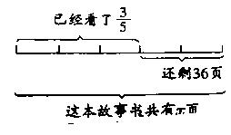

# Mathematics (Grade 5)

**ID**: 33131d2f
**难度**: medium
**题型**: short_answer

## 题目
看图列方程解答

 已经看了
 $\frac{3}{5}$
  还剩36页  这本故事书共有x页

## 解答

**答案**: 90

1. Step1:设这本故事书共有x页
2. Step2:因为已经看了全书的$rac{3}{5}$，所以看了的页数为$rac{3}{5}x$页
3. Step3:已知还剩36页，由总页数x减去看了的页数$rac{3}{5}x$等于剩下的36页，可列出方程$x - rac{3}{5}x = 36$
4. Step4:对$x - rac{3}{5}x$进行计算，得到$rac{2}{5}x$，方程变为$rac{2}{5}x = 36$
5. Step5:求解方程$rac{2}{5}x = 36$，两边同时除以$rac{2}{5}$，即$x = 36\divrac{2}{5}=36	imesrac{5}{2}=90$，得出这本故事书共有90页

## 知识点

**知识点**:
  - --

---
