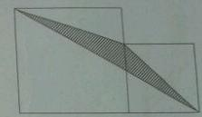

# Mathematics (Grade 5)

**ID**: 331f2be3
**难度**: medium
**题型**: short_answer

## 题目
下图中大正方形的边长是6cm，小正方形的边长是4cm，求阴影部分的面积.

## 解答

**答案**: 18

1. Step1:计算大正方形的面积，根据正方形面积公式S=a²（a为边长），可得大正方形面积为6×6 = 36平方厘米
2. Step2:计算小正方形的面积，根据正方形面积公式可得小正方形面积为4×4 = 16平方厘米
3. Step3:计算第一个三角形的面积，该三角形底为6 + 4厘米，高为6厘米，根据三角形面积公式S=ah÷2（a为底，h为高），可得其面积为(6 + 4)×6÷2 = 30平方厘米
4. Step4:计算第二个三角形的面积，该三角形底和高均为4厘米，根据三角形面积公式可得其面积为4×4÷2 = 8平方厘米
5. Step5:计算第三个三角形的面积，该三角形底为6 - 4厘米，高为6厘米，根据三角形面积公式可得其面积为(6 - 4)×6÷2 = 6平方厘米
6. Step6:计算两个正方形面积之和，为36 + 16 = 52平方厘米
7. Step7:计算三个三角形面积之和，为30 + 8 + 6 = 44平方厘米
8. Step8:用两个正方形面积之和减去三个三角形面积之和，即52 - 44 = 8平方厘米

## 知识点

**知识点**:
  - --

---
