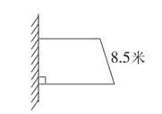

# Mathematics (Grade 5)

**ID**: 3d0e48c0
**难度**: medium
**题型**: short_answer

## 题目
李大爷靠墙用篱笆围了一块直角梯形菜地(如下图)，已知篱笆的总长度是32.5米，梯形的高是8米，这块菜地的面积是多少平方米？

## 解答

**答案**: 96平方米

1. Step1:明确篱笆总长度是32.5米，梯形高是8.5米，因为靠墙围梯形，所以篱笆长度是上底、下底与高其中一边的和，这里高已知为8.5米，那么上底与下底的和为32.5 - 8.5
2. Step2:根据梯形面积公式S=(a + b)h÷2（其中a、b为上底和下底，h为高），这里上底与下底的和是32.5 - 8.5，高是8.5米，所以面积为(32.5 - 8.5)×8.5÷2
3. Step3:计算(32.5 - 8.5)×8.5÷2的结果为96平方米

## 知识点

**知识点**:
  - 小学数学;数与代数;应用题;面积、体积相关应用题;梯形相关的应用题

---
