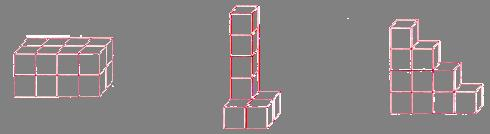

# Mathematics (Grade 5)

**ID**: 3f4d1af5
**难度**: medium
**题型**: short_answer

## 题目
下列图形都是用体积为1立方厘米的小正方体拼成的，分别求出它们的体积。

## 解答

**答案**: 16立方厘米, 8立方厘米, 10立方厘米

1. Step1:观察图一，数出其小正方体个数为16个，因为每个小正方体体积为1立方厘米，所以图一体积为16×1 = 16立方厘米
2. Step2:观察图二，数出其小正方体个数为8个，由于每个小正方体体积为1立方厘米，因此图二体积为8×1 = 8立方厘米
3. Step3:观察图三，数出其小正方体个数为10个，鉴于每个小正方体体积为1立方厘米，故图三体积为10×1 = 10立方厘米

## 知识点

**知识点**:
  - 小学数学;数与代数;应用题;面积、体积相关应用题

---
