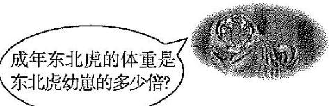

# Mathematics (Grade 5)

**ID**: 421f3d6a
**难度**: medium
**题型**: short_answer

## 题目
八达岭野生动物园有一只成年东北虎，体重是181.5千克，一只东北虎幼崽的体重是30千克

 成年东北虎的体重是东北虎幼崽的多少倍？

## 解答

**答案**: 6.50

1. Step1:明确问题是求成年东北虎体重是东北虎幼崽体重的倍数
2. Step2:根据倍数关系，确定用成年东北虎的体重除以东北虎幼崽的体重，即181.5÷30
3. Step3:计算181.5÷30的结果为6.05

## 知识点

**知识点**:
  - 小数除法-小数除以整数（二）
-

---
