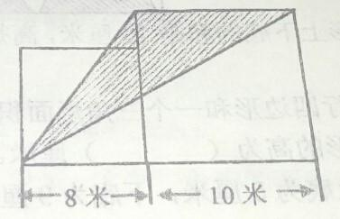

# Mathematics (Grade 5)

**ID**: 42552f45
**难度**: medium
**题型**: short_answer

## 题目
求图中阴影部分的面积

 8米  10米

## 解答

**答案**: 50

1. Step1:观察图形，确定阴影部分为三角形
2. Step2:明确三角形的底为10米
3. Step3:明确三角形的高为10米
4. Step4:根据三角形面积公式，计算面积为10×10÷2
5. Step5:得出结果为50平方米

## 知识点

**知识点**:
  - --

---
