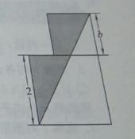

# Mathematics (Grade 5)

**ID**: 4e914b0b
**难度**: medium
**题型**: short_answer

## 题目
如图，两个小正方形放在一起，求阴影部分的面积

## 解答

**答案**: 2-b+b²

1. Step1:设小正方形边长为2，大正方形边长为b
2. Step2:分别计算两个正方形的面积，小正方形面积为2×2 = 2²，大正方形面积为b×b = b²
3. Step3:计算空白三角形的面积，其底为2 + b，高为2，根据三角形面积公式S = 底×高÷2，可得面积为2×(2 + b)÷2
4. Step4:用两个正方形面积之和减去空白三角形的面积求阴影部分面积，即2² + b² - 2×(2 + b)÷2
5. Step5:对2² + b² - 2×(2 + b)÷2进行化简，先计算2×(2 + b)÷2 = 2 + b，式子变为4 + b² - 2 - b，进一步化简得到2 - b + b²

## 知识点

**知识点**:
  - --

---
