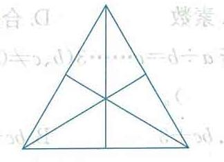

# Mathematics (Grade 5)

**ID**: 502df0d2
**难度**: medium
**题型**: short_answer

## 题目
数一数， 下图中共有多少个三角形？

## 解答

**答案**: 16

1. Step1:明确图中存在不同组合方式构成的三角形
2. Step2:数出小三角形的数量为6个
3. Step3:数出由三个小三角形组成的三角形数量为6个
4. Step4:数出由两个小三角形组成的三角形数量为3个
5. Step5:数出大三角形数量为1个
6. Step6:将各类三角形数量相加，即6 + 6 + 3 + 1 = 16个

## 知识点

**知识点**:
  - 用字母表示数-第七、八单元综合测试卷
-

---
