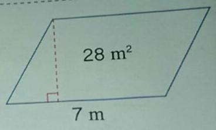

# Mathematics (Grade 5)

**ID**: 529bff2a
**难度**: medium
**题型**: short_answer

## 题目
这个平行四边形的高是多少？

 28m²  7m

## 解答

**答案**: 4m

1. Step1:明确已知条件，平行四边形面积为28m²，底为7m
2. Step2:根据平行四边形面积公式面积 = 底×高，推导出高 = 面积÷底
3. Step3:将面积28m²和底7m代入公式，计算28÷7
4. Step4:得出计算结果为4m，即平行四边形的高是4m

## 知识点

**知识点**:
  - --

---
