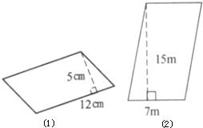

# Mathematics (Grade 5)

**ID**: 564989dd
**难度**: medium
**题型**: short_answer

## 题目
求下面平行四边形的面积．

（1）
（2）

## 解答

**答案**: 60, 105

1. Step1:对于第一个平行四边形，已知底为12cm，高为5cm，根据平行四边形面积公式底×高，可得面积为12×5 = 60平方厘米
2. Step2:对于第二个平行四边形，已知底为7m，高为15m，根据平行四边形面积公式底×高，可得面积为7×15 = 105平方米
3. Step3:将两个平行四边形的面积整理成列表，得到['60', '105']

## 知识点

**知识点**:
  - 平行四边形的面积．

---
