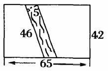

# Mathematics (Grade 5)

**ID**: 5657714d
**难度**: medium
**题型**: short_answer

## 题目
有一条水渠穿过一块长方形地(如图所示，单位：米)，这块地的实际耕地面积是多少平方米？

## 解答

**答案**: 2500

1. Step1:根据长方形面积公式S = a×b（其中a为长，b为宽），计算长方形地的面积，长为65米，宽为42米，所以长方形面积为65×42 = 2730平方米
2. Step2:根据平行四边形面积公式S = a×h（其中a为底，h为高），计算水渠（平行四边形）的面积，底为5米，高为46米，所以平行四边形面积为46×5 = 230平方米
3. Step3:用长方形地的面积减去水渠的面积，得到实际耕地面积，即2730 - 230 = 2500平方米

## 知识点

**知识点**:
  - --

---
