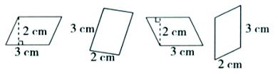

# Mathematics (Grade 5)

**ID**: 6ca35ad2
**难度**: medium
**题型**: short_answer

## 题目
下面有四个平行四边形，小明认为它们的面积都是6平方厘米，你认为他说得对吗？说说你的观点。

## 解答

**答案**: 不对

1. Step1:明确平行四边形面积计算公式为底×高
2. Step2:分析第2个和第4个平行四边形，其相邻两边乘积为6，但高小于相邻边，所以面积小于6平方厘米
3. Step3:得出小明说法不对的结论

## 知识点

**知识点**:
  - 

---
