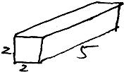

# Mathematics (Grade 5)

**ID**: 6cae20f8
**难度**: medium
**题型**: short_answer

## 题目
求下面图形的体积和表面积．(单位：cm)

## 解答

**答案**: 20, 48

1. Step1:明确图形为长方体，长为5cm，宽为2cm，高为2cm
2. Step2:根据长方体体积公式v=abh，其中a=5，b=2，h=2，计算体积v=2×2×5=20立方厘米
3. Step3:根据长方体表面积公式s=(ab+ah+bh)×2，先计算2×2×2+2×5×4，2×2×2=8，2×5×4=40，再计算8 + 40 = 48平方厘米，得到表面积为48平方厘米

## 知识点

**知识点**:
  - 长方体和正方体的表面积;长方体和正方体的体积．

---
