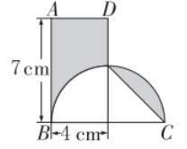

# Mathematics (Grade 5)

**ID**: 6eabb7c6
**难度**: medium
**题型**: short_answer

## 题目
求下列阴影部分的面积。    

## 解答

**答案**: 20

1. Step1:计算梯形上底，7 - 4 = 3厘米
2. Step2:明确梯形下底为7厘米
3. Step3:明确梯形高为4厘米
4. Step4:根据梯形面积公式（上底 + 下底）×高÷2，代入数据计算，即(3 + 7)×4÷2
5. Step5:先计算括号内3 + 7 = 10
6. Step6:再计算10×4 = 40
7. Step7:最后计算40÷2 = 20平方厘米

## 知识点

**知识点**:
  - 组合图形的面积;梯形的面积

---
