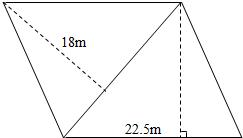

# Mathematics (Grade 5)

**ID**: 7dd1b115
**难度**: medium
**题型**: short_answer

## 题目
图中两个三角形的面积分别是540m$^{2}$，求平行四边形面积．

## 解答

**答案**: 1080

1. Step1:明确平行四边形的面积是两个三角形面积的和
2. Step2:已知每个三角形面积为540平方米，计算两个三角形面积之和，即540×2
3. Step3:得出540×2 = 1080平方米，此即为平行四边形的面积

## 知识点

**知识点**:
  - 平行四边形的面积;三角形的周长和面积

---
