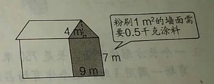

# Mathematics (Grade 5)

**ID**: 81b50a4b
**难度**: medium
**题型**: short_answer

## 题目
粉刷这面墙需要多少千克涂料？如果每千克涂料要16元，那粉刷这面墙一共要多少元？
 4m，9m，7m，粉刷1m²的墙地面需要0.5千克涂料。

## 解答

**答案**: 162, 2592

1. Step1:计算墙的面积，墙由一个长方形和一个三角形组成，长方形面积为长×宽即9×7 = 63平方米，三角形面积为底×高÷2即9×4÷2 = 18平方米，总面积为63 + 18 = 81平方米
2. Step2:已知粉刷1m²的墙面需要0.5千克涂料，用墙的总面积81平方米除以1平方米所需涂料量0.5千克，可得需要涂料81÷0.5 = 162千克
3. Step3:已知每千克涂料要16元，用所需涂料的千克数162千克乘每千克涂料的价格16元，可得粉刷这面墙一共要162×16 = 2592元

## 知识点

**知识点**:
  - --

---
