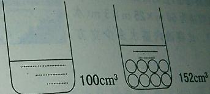

# Mathematics (Grade 5)

**ID**: 82c85179
**难度**: medium
**题型**: short_answer

## 题目
每粒玻璃球的体积是多少立方厘米？

 100cm³  152cm³

## 解答

**答案**: 6.5

1. Step1:观察图可知，放入8粒玻璃球后，体积从100cm³变为152cm³，所以8粒玻璃球的总体积为152 - 100 = 52cm³
2. Step2:已知8粒玻璃球总体积为52cm³，要求每粒玻璃球的体积，根据除法的意义，用总体积除以玻璃球的粒数，即52÷8 = 6.5cm³

## 知识点

**知识点**:
  - 

---
