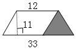

# Mathematics (Grade 5)

**ID**: 834e9802
**难度**: medium
**题型**: short_answer

## 题目
算出如图图形中涂色部分的面积．（单位：厘米）

## 解答

**答案**: 115.5

1. Step1:明确涂色部分是三角形
2. Step2:计算三角形的底，33 - 12 = 21厘米
3. Step3:确定三角形的高为11厘米
4. Step4:根据三角形面积公式计算面积，21×11÷2 = 115.5平方厘米

## 知识点

**知识点**:
  - 三角形的周长和面积

---
