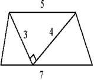

# Mathematics (Grade 5)

**ID**: 8fd6dcb7
**难度**: medium
**题型**: short_answer

## 题目
求下面梯形的面积．(单位：米)

## 解答

**答案**: 14.4

1. Step1:根据直角三角形面积公式，计算出直角三角形面积为3×4÷2 = 6平方米
2. Step2:根据三角形面积公式的变形，计算出直角三角形斜边上的高为6×2÷5 = 2.4米，此高也是梯形的高
3. Step3:根据梯形面积公式，计算梯形面积为(5 + 7)×2.4÷2 = 14.4平方米

## 知识点

**知识点**:
  - 小学数学;图形与几何;平面图形;梯形的特征及分类;梯形的面积

---
