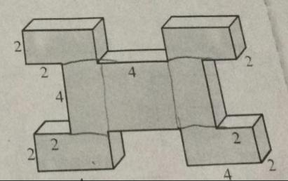

# Mathematics (Grade 5)

**ID**: 938e76aa
**难度**: medium
**题型**: short_answer

## 题目
如图，计算这个组合体的体积.（图中单位：cm）

 2  2  4  2  2  4  2  2  2  4

## 解答

**答案**: 128

1. Step1:分析组合体可知，可将其拆分为四个长4cm、宽2cm、高2cm的长方体和一个长8cm、宽4cm、高2cm的长方体
2. Step2:根据长方体体积公式V = a×b×h（a为长，b为宽，h为高），计算四个长4cm、宽2cm、高2cm的长方体体积，即4×2×2×4
3. Step3:计算长8cm、宽4cm、高2cm的长方体体积，即8×4×2
4. Step4:将上述两部分体积相加，即4×2×2×4 + 8×4×2
5. Step5:计算4×2×2×4 + 8×4×2的结果，先算4×2×2×4=32×2 = 64，8×4×2 = 32×2 = 64
6. Step6:再算64 + 64 = 128，得到组合体体积为128cm³

## 知识点

**知识点**:
  - 

---
