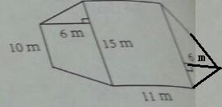

# Mathematics (Grade 5)

**ID**: 941034d6
**难度**: medium
**题型**: short_answer

## 题目
下图是小玉家的菜地，你能算算她家菜地的面积有多大吗？

 10m；6m；15m；6m；11m

## 解答

**答案**: 295

1. Step1:计算梯形面积，梯形上底为10m，下底为15m，高为6m，根据梯形面积公式S=(a + b)×h÷2，可得(10 + 15)×6÷2 = 75平方米
2. Step2:计算长方形面积，长方形长为15m，宽为11m，根据长方形面积公式S = a×b，可得15×11 = 165平方米
3. Step3:计算三角形面积，三角形底为15m，高为6m，根据三角形面积公式S = a×h÷2，可得15×6÷2 = 45平方米
4. Step4:将梯形、长方形、三角形面积相加，即75 + 165 + 45 = 295平方米

## 知识点

**知识点**:
  - --

---
