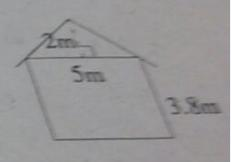

# Mathematics (Grade 5)

**ID**: 9803d2f7
**难度**: medium
**题型**: short_answer

## 题目
如图是教室的一面墙，如果工人师傅砌这面墙每平方米需要用196块砖，那么一共需要用多少块砖？

 2m，5m，3.8m

## 解答

**答案**: 4704

1. Step1:计算长方形部分的面积，长方形面积=长×宽，即5×3.8 = 19平方米
2. Step2:计算三角形部分的面积，三角形面积=底×高÷2，即5×2÷2 = 5平方米
3. Step3:计算这面墙的总面积，总面积=长方形面积+三角形面积，即19 + 5 = 24平方米
4. Step4:根据公式“砖块数=总面积×每平方米需要用砖数”，计算所需砖块数，即24×196 = 4704块

## 知识点

**知识点**:
  - --

---
