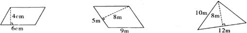

# Mathematics (Grade 5)

**ID**: 99bbd229
**难度**: medium
**题型**: short_answer

## 题目
计算下列图形的面积：
 。

## 解答

**答案**: 24, 40, 48

1. Step1:第一个图形是平行四边形，底为6cm，高为4cm，根据平行四边形面积公式底×高，可得其面积为4×6 = 24平方厘米
2. Step2:第二个图形是平行四边形，底为5m，高为8m，根据平行四边形面积公式底×高，可得其面积为5×8 = 40平方米
3. Step3:第三个图形是三角形，底为12m，高为8m，根据三角形面积公式底×高÷2，可得其面积为12×8÷2 = 48平方米

## 知识点

**知识点**:
  - 平行四边形的面积;三角形的周长和面积．

---
