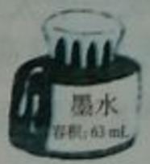

# Mathematics (Grade 5)

**ID**: 99f09079
**难度**: medium
**题型**: short_answer

## 题目
明明买来一瓶墨水，如果每天用去0.5毫升，这瓶墨水可以用多少天？

 墨水  容积：63ml

## 解答

**答案**: 126

1. Step1:明确问题是求这瓶墨水能用多少天，已知墨水容积为63毫升，每天用0.5毫升
2. Step2:根据求一个数里面有几个另一个数用除法的原理，确定用墨水的总容积63毫升除以每天用的0.5毫升来计算天数
3. Step3:计算63÷0.5的结果为126，得到这瓶墨水可以用的天数

## 知识点

**知识点**:
  - 

---
