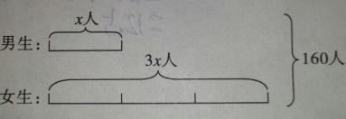

# Mathematics (Grade 5)

**ID**: a20ae3d4
**难度**: medium
**题型**: short_answer

## 题目
根据数量关系列方程并求解．

 男生：x人
 女生：3x人
 160人

## 解答

**答案**: 40, 120

1. Step1:根据题目可知男生人数为x人，女生人数为3x人，且男生人数与女生人数总和为160人，由此列出方程x + 3x = 160
2. Step2:对x + 3x进行合并同类项，得到4x = 160
3. Step3:方程4x = 160两边同时除以4，解得x = 40，此为男生人数
4. Step4:将x = 40代入3x，计算3×40 = 120，此为女生人数

## 知识点

**知识点**:
  - --

---
