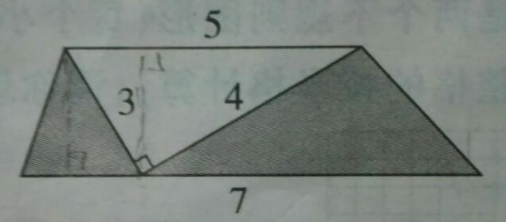

# Mathematics (Grade 5)

**ID**: c42ae500
**难度**: medium
**题型**: short_answer

## 题目
阴影部分的面积是多少？（单位：cm）

## 解答

**答案**: 8.4

1. Step1:根据直角三角形两条直角边分别为3厘米和4厘米，利用三角形面积公式S = a×b÷2（a、b为直角边），求出空白三角形面积为3×4÷2 = 6平方厘米
2. Step2:已知空白三角形的斜边为5厘米，根据三角形面积公式S = c×h÷2（c为斜边，h为斜边上的高），由面积6平方厘米和斜边5厘米可求出斜边上的高，即梯形的高为6×2÷5 = 2.4厘米
3. Step3:根据梯形面积公式S=(a + b)×h÷2（a为上底，b为下底，h为高），其中上底为5厘米，下底为7厘米，高为2.4厘米，求出梯形面积为(5 + 7)×2.4÷2 = 14.4平方厘米
4. Step4:用梯形面积14.4平方厘米减去空白三角形面积6平方厘米，得到阴影部分面积为14.4 - 6 = 8.4平方厘米

## 知识点

**知识点**:
  - --

---
