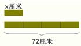

# Mathematics (Grade 5)

**ID**: c611860d
**难度**: medium
**题型**: short_answer

## 题目
看图列方程

## 解答

**答案**: x=18

1. Step1:根据图中信息，明确第二条线段长度为72厘米，且第二条线段长度是第一条线段长度的4倍，设第一条线段长度为x厘米
2. Step2:根据倍数关系列出方程4x = 72
3. Step3:对方程4x = 72求解，等式两边同时除以4，得到x = 72÷4
4. Step4:计算72÷4的值为18，得出x = 18

## 知识点

**知识点**:
  - 列方程解应用题（两步需要逆思考）．

---
