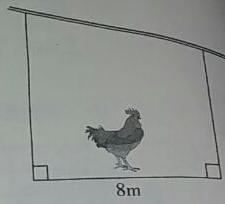

# Mathematics (Grade 5)

**ID**: c6ac9aa1
**难度**: medium
**题型**: short_answer

## 题目
张豪用篱笆围一个一面靠墙的鸡舍（如图所示），已知篱笆全长24m，这个鸡舍的面积是多少平方米？

 8m

## 解答

**答案**: 54(m^{2})

1. Step1:明确篱笆全长24m，其中一条边为8m，因为一面靠墙，所以鸡舍上底和下底的和为24 - 8 = 16m
2. Step2:由于鸡舍可看作梯形，根据梯形面积公式S=(上底 + 下底)×高÷2，这里高为8m，上底和下底的和为16m，所以面积为16×8÷2 = 54m²

## 知识点

**知识点**:
  - --

---
