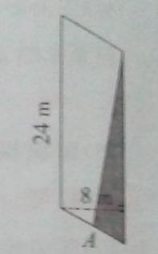

# Mathematics (Grade 5)

**ID**: c6d7751f
**难度**: medium
**题型**: short_answer

## 题目
图中A是中点，求出图中阴影部分的面积.

 24m
 8m
 A

## 解答

**答案**: 48m²

1. Step1:因为点A是中点，所以阴影三角形的底为8÷2 = 4m
2. Step2:由图可知阴影三角形的高是24m
3. Step3:根据三角形面积公式，面积=底×高÷2，可得阴影部分面积为24×4÷2 = 48m²

## 知识点

**知识点**:
  - --

---
