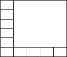

# Mathematics (Grade 5)

**ID**: cd5d8cd7
**难度**: medium
**题型**: short_answer

## 题目
一张扑克牌的面积是46平方厘米。兰兰用这张扑克牌来测量报纸的面积（如下图），这张报纸的面积大约是多少平方厘米？

## 解答

**答案**: 1380平方厘米

1. Step1:观察图形可知，报纸的长大约可以摆6张扑克牌，宽大约可以摆5张扑克牌
2. Step2:根据长方形面积的计算思路，铺满报纸所需扑克牌的总张数为长摆的张数乘以宽摆的张数，即5×6 = 30张
3. Step3:已知一张扑克牌面积是46平方厘米，那么报纸面积为扑克牌总张数乘以一张扑克牌的面积，即30×46 = 1380平方厘米

## 知识点

**知识点**:
  - 小学数学;数与代数;应用题;面积、体积相关应用题;长方形、正方形相关的应用题

---
