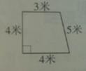

# Mathematics (Grade 5)

**ID**: ce759cc4
**难度**: medium
**题型**: short_answer

## 题目
小猪房子的地面是一个梯形(如下图)。它的占地面积是多少？

 3米  4米  5米  4米

## 解答

**答案**: 14

1. Step1:明确梯形面积公式为梯形面积=(上底+下底)×高÷2
2. Step2:由图可知该梯形上底为3米，下底为4米，高为4米
3. Step3:将上底3米、下底4米、高4米代入梯形面积公式，得到(3 + 4)×4÷2
4. Step4:先计算括号内3 + 4 = 7
5. Step5:再计算7×4 = 28
6. Step6:最后计算28÷2 = 14，得出面积为14平方米

## 知识点

**知识点**:
  - --

---
