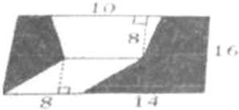

# Mathematics (Grade 5)

**ID**: e2aa7df6
**难度**: medium
**题型**: short_answer

## 题目
求下列图中阴影部分的面积．

## 解答

**答案**: 216

1. Step1:明确计算方法为用大平行四边形的面积减去中间小平行四边形和梯形的面积
2. Step2:计算大平行四边形的面积，根据平行四边形面积公式 S = 底×高，底为(8 + 14)，高为16，可得面积为(8 + 14)×16 = 352
3. Step3:计算中间小平行四边形的面积，底为8，高为8，面积为8×8 = 64
4. Step4:计算梯形的面积，根据梯形面积公式 S=(上底 + 下底)×高÷2，上底为8，下底为10，高为8，可得面积为(8 + 10)×8÷2 = 72
5. Step5:计算阴影部分面积，用大平行四边形面积减去小平行四边形面积和梯形面积，即352 - 64 - 72 = 216

## 知识点

**知识点**:
  - 组合图形的面积

---
