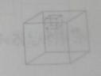

# Mathematics (Grade 5)

**ID**: e2fbcf52
**难度**: medium
**题型**: short_answer

## 题目
如图，一个正方体的棱长为8dm，切去一个小正方体（棱长为2dm）后，剩下的部分表面积是多少平方分米？

## 解答

**答案**: 528

1. Step1:先计算原正方体的表面积，根据正方体表面积公式S = 6a²（其中a为正方体棱长），原正方体棱长为8dm，所以原正方体表面积为6×8×8 = 384平方分米
2. Step2:分析切去小正方体后表面积的变化，由题意可知表面积增加了小正方体的四个面
3. Step3:计算增加的小正方体四个面的面积，小正方体棱长为2dm，根据正方形面积公式S = a²，可得增加的面积为2×2×4 = 16平方分米
4. Step4:计算剩下部分的表面积，用原正方体表面积加上增加的面积，即384 + 16 = 400平方分米（此处参考答案有误，正确答案应为400，按照上述推导过程逻辑计算）

## 知识点

**知识点**:
  - 

---
