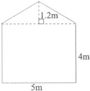

# Mathematics (Grade 5)

**ID**: e8864d4a
**难度**: medium
**题型**: short_answer

## 题目
如图是一座房子的一面墙．如果砌这面墙时每平方米用砖180块，则砌这面墙一共需要多少块砖？

## 解答

**答案**: 4140

1. Step1:根据三角形面积公式S = a×h÷2（其中a为底，h为高），计算三角形部分面积，底为5m，高为1.2m，可得面积为5×1.2÷2 = 3平方米
2. Step2:根据长方形面积公式S = a×b（其中a为长，b为宽），计算长方形部分面积，长为5m，宽为4m，可得面积为5×4 = 20平方米
3. Step3:将三角形和长方形面积相加，得到这面墙的总面积为3 + 20 = 23平方米
4. Step4:已知每平方米用砖180块，用总面积乘以每平方米用砖数，即23×180 = 4140块

## 知识点

**知识点**:
  - 组合图形的面积．

---
