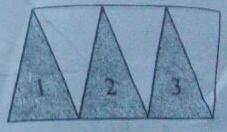

# Mathematics (Grade 5)

**ID**: e96dae78
**难度**: medium
**题型**: short_answer

## 题目
下图中平行四边形的面积是20平方厘米。你能求出阴影部分的总面积吗？

## 解答

**答案**: 10

1. Step1:根据图形可知，三角形1，2，3的高与平行四边形的高相等，三角形1，2，3的三个底的和是平行四边形的底。
2. Step2:由上述关系可得，这三个三角形的面积和是平行四边形面积的一半。
3. Step3:已知平行四边形面积是20平方厘米，所以阴影部分总面积为20÷2=10平方厘米。

## 知识点

**知识点**:
  - --

---
