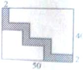

# Mathematics (Grade 5)

**ID**: ea1213c1
**难度**: medium
**题型**: short_answer

## 题目
求图中阴影部分的面积．（单位：cm） 

## 解答

**答案**: 180

1. Step1:根据图意确定阴影部分由一个长为50cm、宽为2cm的长方形和一个长为40cm、宽为2cm的长方形组成
2. Step2:计算长为50cm、宽为2cm的长方形的面积，根据长方形面积公式S = a×b（a为长，b为宽），可得50×2 = 100平方厘米
3. Step3:计算长为40cm、宽为2cm的长方形的面积，根据长方形面积公式S = a×b，可得40×2 = 80平方厘米
4. Step4:求阴影部分面积，将两个长方形面积相加，即100 + 80 = 180平方厘米

## 知识点

**知识点**:
  - 组合图形的面积

---
