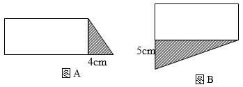

# Mathematics (Grade 5)

**ID**: ef1e2cce
**难度**: medium
**题型**: short_answer

## 题目
有一个长方形。如图A，如果一条长增加4cm，宽不变，面积增加12cm$^{2}$；如图B，如果一条宽增加5cm，长不变，面积增加25cm$^{2}$。那么原长方形的面积是多少？

## 解答

**答案**: 60

1. Step1:根据图A，增加的部分是一个三角形，面积为12cm²，底为4cm，由三角形面积公式S = 1/2×底×高，可推出原长方形的宽为12×2÷4 = 6厘米
2. Step2:根据图B，增加的部分是一个长方形，面积为25cm²，宽为5cm，由长方形面积公式S = 长×宽，可推出原长方形的长为25÷5 = 5厘米
3. Step3:根据长方形面积公式S = 长×宽，原长方形长为5厘米，宽为6厘米，所以原长方形面积为5×6 = 30平方厘米

## 知识点

**知识点**:
  - 小学数学;数与代数;应用题;复合应用题

---
