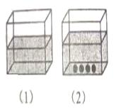

# Mathematics (Grade 5)

**ID**: f636caf6
**难度**: medium
**题型**: short_answer

## 题目
玲玲加有一个长方形玻璃鱼缸，长8dm、宽4dm、高6dm．

（1）制作这个鱼缸至少需要玻璃多少dm$^{2}$？（鱼缸的上面没有玻璃）
（2）鱼缸原来有一些水，（如图1），放入四个相同大小的装饰球后（如图2），水面上升了5cm．每个装饰球的体积是多少dm$^{2}$？

## 解答

**答案**: 176, 4

1. Step1:计算制作鱼缸所需玻璃面积，因为鱼缸上面没有玻璃，所以面积为长×宽 + 长×高×2 + 宽×高×2，即 8×4 + 8×6×2 + 4×6×2 = 32 + 96 + 48 = 176(dm²)
2. Step2:先将水面上升的高度 5cm 换算为 0.5dm，根据长方体体积公式，四个装饰球的总体积为长×宽×水面上升高度，即 8×4×0.5 = 16(dm³)，再计算每个装饰球体积为 16÷4 = 4(dm³)

## 知识点

**知识点**:
  - 小学数学;数与代数;应用题;面积、体积相关应用题;图形与几何;立体图形;不规则物体的体积算法

---
